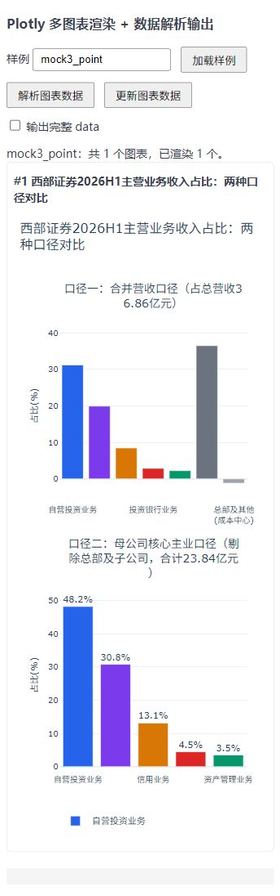
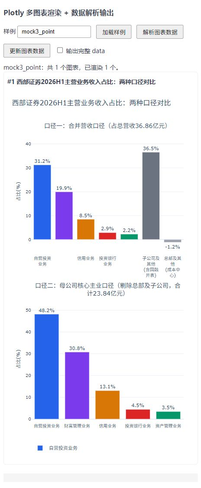

# Plotly Responsive Skill

**让 AI 生成的 Plotly 图表，在手机上也能清楚阅读。**

面向模型输出的标准 `{ data, layout, config }`，提供一套可复用的响应式布局 skill 和 JavaScript 适配器。按图表容器的实际宽度计算标题、子图、图例、色条与交互控件的位置，适合移动端数据看板、聊天中的图表卡片，以及宽度会变化的前端面板。

核心适配器不依赖前端框架，也不需要模型重新生成数据；可通过浏览器脚本或 CommonJS 接入。仓库演示使用固定版本 **Plotly.js 4.1.1**。

## 移动端效果

**以 360px 手机视口作为最低视觉验收尺寸，同时保留 480px 对照。** 规则回归还覆盖 420px、520px，以及卡片内边距和滚动条占用后的实际容器宽度。

适配器的窄屏阈值是 **容器宽度小于 560px**。判断依据是图表实际可用空间，因此桌面上的窄侧栏也会启用相同的适配。

| 移动端常见问题 | 适配效果 |
| --- | --- |
| 并排子图各占半屏，图形和标题拥挤 | 按原行列顺序纵向排列，子图标题跟随所属面板移动，增加图表高度 |
| 长中文标题、副标题超出边界 | 自动换行并预留完整行高，保留 `<b>`、`<sup>` 等富文本 |
| 分类刻度密集、长标签互相覆盖 | 换行并显示有代表性的刻度，保留首尾，原始类别和数据仍保留 |
| 图例、脚注、按钮挤在一起 | 按各自需要的空间分配底部区域；下拉菜单向上展开 |
| 竖向色条挤占绘图区 | 窄屏改为横向色条，单独预留标题、刻度和高度 |
| 折线穿过均值等标注，文字难读 | 为适用的数据坐标标注增加实色底、小内边距和可读前景色，保留参考坐标 |
| 散点或柱形数据标签重叠、被裁切 | 渲染后按真实 SVG 边界检查，可隐藏拥挤的可选标签，数据与 hover 保留 |
| 手机横竖屏切换、卡片宽度变化 | 使用 `ResizeObserver` 从完整源配置重新适配，宽屏恢复对应布局 |

### 实际渲染截图

下面是同一份双子图输入在两个视口下的截图：窄屏纵向排列两个面板，标题随宽度换行；360px 下部分可选标签隐藏，480px 下更多标签可见。

<table>
  <tr><th>360px 视口</th><th>480px 视口</th></tr>
  <tr>
    <td valign="top"></td>
    <td valign="top"></td>
  </tr>
</table>

截图来自 2026-10-14 的 `mock3_point` 浏览器验收。它们用于展示布局效果，图中的示例数据不作为业务结论。图片随 README 保存，不依赖被忽略的本地报告目录。

## 作为 AI Skill 使用

将整个 [`skills/plotly-responsive/`](skills/plotly-responsive/) 目录复制到目标项目，保留 `SKILL.md`、`assets/` 和 `references/` 的相对路径。可在目标项目的 `AGENTS.md` 中加入：

```markdown
处理 Plotly 图表的移动端适配、布局重叠或裁切问题时，
先阅读 skills/plotly-responsive/SKILL.md。
保留原始模型输出，修复可复用适配层，并验证 360px 和 480px 的实际渲染。
```

也可按所用 AI 编程工具的技能发现规则，将该目录放入其支持的 skills 目录。

示例指令：

```text
使用 plotly-responsive skill，适配这份模型生成的 Plotly figure。
重点检查 360px 手机视口下的标题、图例、刻度、色条和子图。
容器宽度变化时从完整源配置重新计算，保留数据、轴引用和交互状态。
完成后提供 360px 与 480px 的截图和回归结果。
```

Skill 的作用是指导接入、排查和验证；页面运行时需要实际加载 JavaScript 适配器。

## 在前端中使用

### 最小接入

将适配器复制到前端静态资源或源码目录。下面的示例假设 HTML 位于仓库根目录，Plotly 文件和适配器均可访问：

```html
<meta name="viewport" content="width=device-width, initial-scale=1.0">
<script src="./plotly-4.1.1.min.js"></script>
<script src="./skills/plotly-responsive/assets/plotly-responsive.js"></script>

<div id="chart" style="width: 100%; min-width: 0;"></div>

<script>
  const container = document.getElementById('chart');
  const source = PlotlyResponsive.normalizeValue({
    data: [{
      type: 'bar',
      x: ['移动端访问', '桌面端访问', '其他访问'],
      y: [68, 25, 7]
    }],
    layout: {
      title: { text: '不同终端的访问占比：移动端图表适配示例' },
      yaxis: { title: { text: '占比（%）' } }
    },
    config: {}
  });

  async function render() {
    const width = container.getBoundingClientRect().width;
    if (width <= 0) return;
    const fitted = PlotlyResponsive.fitFigure(source, width);
    container.style.height = fitted.height + 'px';
    await Plotly.newPlot(container, fitted.data, fitted.layout, fitted.config);
    await new Promise(resolve => requestAnimationFrame(resolve));
    PlotlyResponsive.resolveTextCollisions(container);
    console.log(fitted.warnings);
  }

  render().catch(console.error);
</script>
```

上面演示首次渲染。完整的容器监听、数据更新和交互状态接入可参考 [接入说明](skills/plotly-responsive/references/integration.md)。Plotly.js 需由目标项目自行提供；本地演示使用的压缩包不纳入 Git。

### 响应式接入要点

1. **测量容器宽度。** 使用 `container.getBoundingClientRect().width`，包含卡片布局影响；隐藏容器宽度为零时，等容器可见后再渲染。
2. **保存完整源配置。** 每次宽度变化都从源 figure 调用 `fitFigure`，按返回的 `height` 设置容器高度，再用 `Plotly.react` 更新。
3. **监听容器变化。** `ResizeObserver` 只处理宽度变化，合并快速触发的请求并串行渲染。`config.responsive` 不能代替这一步。
4. **等待标签检查。** 首次渲染和后续 `react`、`restyle`、`plotly_afterplot` 后，通过 `requestAnimationFrame` 合并调用 `resolveTextCollisions`；截图应等检查完成。
5. **同步数据与状态。** 数据更新时同步完整源数据；业务切换 figure 时按需更新 `uirevision`。补齐的年份菜单通过 `yearSelections` 保存选择，详见接入说明。
6. **清理组件资源。** 卸载时断开 observer、取消待执行帧、移除事件订阅，并调用 `Plotly.purge`。

React、Vue 等项目可以把这些步骤放入对应的挂载、更新和卸载生命周期。容器处于 Flex/Grid 布局时，注意设置 `min-width: 0`，允许其收缩。

### API

浏览器中使用 `window.PlotlyResponsive`；CommonJS 中使用：

```js
const { fitFigure, normalizeValue, wrapText, resolveTextCollisions } =
  require('./skills/plotly-responsive/assets/plotly-responsive.js');
```

| API | 用途 |
| --- | --- |
| `fitFigure(figure, width, options?)` | 根据容器宽度生成适配结果，不修改传入对象；`options.yearSelections` 可保存补齐年份菜单的选择 |
| `normalizeValue(value)` | 将 TypedArray 和 Plotly `{ dtype, bdata, shape }` 编码转换为普通数组；无效编码显式报错 |
| `wrapText(text, fontSize, maxWidth)` | 根据宽度估算换行，保留支持的富文本标记；返回 `{ text, lines }` |
| `resolveTextCollisions(container)` | 在浏览器渲染后检查 SVG 数据标签，隐藏碰撞或越界的可选标签，返回隐藏数量 |

`fitFigure` 返回 `{ data, layout, config, height, panels, stacked, yearMenus, warnings }`。向 Plotly 传入其中的 `data`、`layout`、`config`；`height` 用于容器尺寸，其余字段用于检查面板布局、菜单和诊断。

## 本地开发与验证

Git 仅纳入 skill、README、项目说明和两张效果图。本节涉及的 `index.html`、Plotly 压缩包、`tests/`、`mocks/` 和 `reports/` 都是本地开发文件，不随开源仓库分发。

### 启动演示

已有本地演示文件时，在仓库根目录启动任意静态 HTTP 服务。例如已安装 Python 时：

```bash
python -m http.server 8080
```

打开 `http://localhost:8080/index.html?mock=mock3_point`，或使用页面的样例输入框切换。默认样例为 `mock2`，支持 `mock3_point` 等带后缀的名称。

新克隆可将上面的最小接入示例保存为 HTML，自行引入固定版本的 Plotly.js 后启动静态服务。以下样例切换功能仅适用于已有本地 `index.html` 的开发环境，演示前还需提供 `mocks/mock2.js` 或指定其他样例文件。独立演示文件的格式如下；真实回归输入应完整保留模型原文：

```js
// mocks/mock2.js
window.mockData = [{
  data: [{ type: 'bar', x: ['A', 'B', 'C'], y: [12, 23, 18] }],
  layout: { title: { text: '移动端演示图表' } },
  config: {}
}];
```

该文件可用于演示，但不能替代完整回归所需的其他 fixtures。演示还需要根目录的 `plotly-4.1.1.min.js`；接入其他项目时使用固定且经过验证的 Plotly 版本。

### 规则回归

本地具备测试脚本和完整 `mocks/` 后，在仓库根目录运行：

```bash
node tests/responsive.test.js
```

测试使用 Node.js 内置测试模块，无需安装测试依赖。本仓库在 Node.js 22.22.0 下验证。测试会自动发现 `mocks/mock*.js`，但部分专项测试还依赖特定样例，因此仅添加一个演示文件不能运行完整套件。

截至 2026-10-14，本地完整 fixtures 的规则回归为 **48/48 通过**，覆盖数据值与轴引用保留、源输入不变、子图布局、宽屏恢复、编码数组、年份筛选和标注可读性等约束。

### 移动端视觉验收

规则测试之外，还需用浏览器检查 **360px、480px** 下的实际效果，并检查窄屏与宽屏之间的切换、数据更新和控件点击。

- 等待所有图表及标签检查完成，保存完整页面截图。
- 检查标题、图例、坐标轴、色条、控件和数据标签的边界及相交情况。
- 检查图形确实存在，包括层级图是否空白、稀疏日期柱形是否可见，以及 SVG 裁切。
- 对适用的数据坐标标注检查实色底、文字包围关系和至少 4.5:1 的实际文字对比度。

本地开发工具 `tests/browser-layout-audit.js` 提供只读 DOM 测量函数，需要在浏览器上下文执行。报告校验器需要先采集截图、测量结果、manifest 和测试输出；它本身不会启动浏览器或生成截图。产物格式见 [接入说明](skills/plotly-responsive/references/integration.md)。本地具备校验脚本、完成采集及截图审阅后运行：

```bash
node tests/write-responsive-report.js reports/responsive-YYYY-MM-DD
```

## 适用范围与边界

- 已有样例覆盖柱形、折线/散点、饼图、极坐标、热力图、Sankey 和层级图，以及多子图组合；其他图型和自定义布局需要新增真实输入验证。
- 碰撞检查目前针对 SVG 的 scatter/polar/bar 数据标签；Canvas/WebGL 文字和自定义扩展需要单独验证。
- 窄屏会隐藏覆盖式 mode bar；需要导出图片等功能时，可由产品界面提供入口。
- 层级结构和缺少年份参数的菜单，仅在有足够证据时修复；结构派生和稀疏日期轴的语义变化通过 `warnings` 报告，不推测业务数据。
- 明暗主题有标注规则测试；自定义内联文字颜色、整体透明度，以及标注底框遮挡关键走势等情况，仍需实际视觉审阅。

## 目录与贡献

```text
skills/plotly-responsive/
  SKILL.md                    # 适配、排查与验证流程
  assets/plotly-responsive.js  # 可复制的运行时适配器
  references/integration.md   # 生命周期、菜单状态与验收接入
  references/fix-log.md       # 已解决问题和验证范围
docs/images/                 # 仅纳入 README 的两张移动端截图
AGENTS.md                    # 项目维护说明
README.md                    # 使用文档
.gitignore                   # 最小发布白名单
```

本地另有演示入口、Plotly 压缩包、测试脚本、原始输入和验收产物，均由 `.gitignore` 排除。

欢迎提交移动端布局问题。请附上可公开的原始 figure、Plotly 版本、视口及容器实际宽度、问题截图和复现步骤。修复时保留输入数据，在可复用适配器中解决一般原因，增加回归测试，并更新 [修复记录](skills/plotly-responsive/references/fix-log.md)。

## 许可证

仓库根目录目前尚未提供 `LICENSE`，本项目的使用和分发授权需在正式开源发布时明确。演示所用 Plotly.js 文件声明采用 MIT 许可证；该声明适用于 Plotly.js，不自动覆盖本项目的 skill 和适配器。
